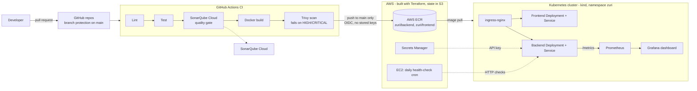

# Zuri Market: DevOps Capstone (April 2026 Cohort)

A two-tier web application (React frontend + Node.js/Express backend) taken from source code to a monitored, scanned, containerised deployment using Terraform, GitHub Actions, Docker, Kubernetes, Prometheus and Grafana.

## The three repositories

| Repo | Purpose |
|------|---------|
| [zuriapp-backend](https://github.com/NelsonOjeaburu/zuriapp-backend) | Express API, Dockerfile, `/metrics` endpoint, CI pipeline |
| [zuriapp-frontend](https://github.com/NelsonOjeaburu/zuriapp-frontend) | Vite/React UI, Dockerfile, nginx config, CI pipeline |
| [zuri-platform](https://github.com/NelsonOjeaburu/zuri-platform) | Everything around the apps: Terraform, Docker Compose, Kubernetes manifests, monitoring, health-check script (this repo) |

## Architecture overview



## What was built

### 1. Infrastructure as code (Terraform)
- Reusable **modules** (`terraform/modules/`) and two environments, **dev** and **prod** (`terraform/environments/`). A small `terraform/bootstrap/` stack creates the state bucket itself.
- **Remote state** in S3 (`zuri-tfstate-884404664929`), so state is shared and not stored on a laptop.
- Provisions the network (VPC), ECR repositories (`zuri/backend`, `zuri/frontend`), the Secrets Manager secret, IAM, and the EC2 host for the health check.
- GitHub Actions authenticates to AWS with **OIDC** and a short-lived role. No AWS access keys are stored in GitHub.

### 2. Containers (Docker and Compose)
- Each app has its own `Dockerfile`. The frontend is served by nginx (`nginx.conf`).
- `docker-compose.yml` runs the whole stack locally with one command.

### 3. CI pipeline (GitHub Actions)
Both app repos run the same stages on every push and pull request to `main`:

1. **Lint** (ESLint)
2. **Test** (unit tests)
3. **SonarQube Cloud analysis with a quality gate.** The step waits for the result and fails the build if the gate fails.
4. **Docker build**
5. **Trivy image scan.** Fails on any fixable HIGH or CRITICAL vulnerability, and the table output is visible in the CI logs.
6. **Push to ECR.** Runs only on pushes to `main`, never on pull requests, and tags the image with the commit SHA and `latest`.

Security hardening: every third-party action is **pinned to a full commit SHA**, workflow permissions are least-privilege, and the SonarQube token lives in a GitHub secret.

### 4. Kubernetes (`k8s/`)
- **Deployments and Services** for backend and frontend, in the `zuri` namespace.
- **Ingress** through ingress-nginx.
- **ConfigMaps** for configuration. The backend API key is stored in **AWS Secrets Manager** (`zuri-dev/backend-api-key`) and reaches the cluster as a Kubernetes **Secret**, never committed to Git.
- **RBAC:** dedicated service accounts `backend-sa`, `frontend-sa` and a read-only `viewer-sa`, each with only the permissions it needs.

### 5. Monitoring (`k8s/monitoring/`)
- The backend exposes Prometheus metrics at `/metrics` (default process metrics plus an HTTP request-duration histogram labelled by method, route and status code).
- **Prometheus** discovers the backend Service through a read-only Role and scrapes it.
- **Grafana** is provisioned from ConfigMaps (datasource and dashboard), so nothing is configured by hand. The "Zuri Market - Backend" dashboard shows request rate by route, 4xx/5xx error share, and p50/p95 latency.
- The Grafana admin password comes from a Kubernetes Secret created with `kubectl`, not from Git.

### 6. Operations: daily health check
- `scripts/health-check.sh` checks the services and writes a report; `scripts/CRON_SETUP.md` explains the schedule. A sample report is in `scripts/health-report.log`.
- It runs **daily from cron on the EC2 host**, appending to `/var/log/zuri-health-report.log`.

### 7. Governance
- **Branch protection on `main`** in all three repos: changes go through pull requests, and the CI check is required on the backend.
- Pull request history shows the work being reviewed and merged in small steps.

## How to run it

### Locally with Docker Compose
```bash
git clone https://github.com/NelsonOjeaburu/zuri-platform.git
cd zuri-platform
docker compose up --build
```

### Kubernetes (kind)
```bash
kubectl apply -f k8s/backend -f k8s/frontend  # Deployments, Services, ConfigMaps
kubectl apply -f k8s/ingress.yaml -f k8s/rbac.yaml
kubectl apply -f k8s/monitoring/              # Prometheus and Grafana
kubectl create secret generic grafana-admin -n monitoring \
  --from-literal=password='<choose-a-password>'
kubectl port-forward -n monitoring svc/grafana 3000:3000   # http://localhost:3000, user: admin
```

### AWS with Terraform
```bash
cd terraform/environments/dev   # or prod
terraform init
terraform plan
terraform apply
```

### Tear down (avoid AWS charges)
```bash
terraform destroy            # run in both dev and prod
```

## Evidence

Screenshots are in `docs/evidence/`:

| Requirement | Evidence |
|-------------|----------|
| Terraform plan/apply, remote state | `terraform-plan.png`, `s3-state.png` |
| Pipeline passes (lint, test, quality gate, Trivy, push) | `ci-green.png` |
| **Pipeline fails when something is wrong** | `ci-sonar-gate-failed.png`, `ci-sonar-gate-log.png` (a deliberately buggy change was blocked, then the pull request was closed unmerged) |
| Trivy output in CI logs | `trivy-log.png` |
| Kubernetes resources and RBAC | `kubectl-get-all.png`, `rbac.png` |
| Secrets Manager | `secrets-manager.png` |
| Grafana dashboard | `grafana-dashboard.png` |
| Daily health report | `health-report.png` |

## Jenkins vs GitHub Actions

| | Jenkins | GitHub Actions |
|---|---|---|
| **Hosting** | You install, patch and scale the server and agents | Managed by GitHub; runners appear on demand |
| **Setup effort** | Server, plugins, credentials and agents before the first build | A YAML file in the repo; first build in minutes |
| **Pipeline definition** | `Jenkinsfile` (Groovy), or UI jobs | YAML workflow in `.github/workflows/` |
| **Reuse and ecosystem** | Over a thousand plugins; powerful but they need upkeep and can conflict | Marketplace of ready-made actions, versioned and easy to pin |
| **Source-control integration** | Via plugins and webhooks | Native: pull request checks, branch protection, secrets and OIDC built in |
| **Cost** | Free software, but you pay for servers and maintenance time | Free minutes for public repos and a free tier for private ones; pay per minute beyond that |
| **Flexibility** | Very high: custom agents, on-premises networks, complex multi-pipeline orchestration | High for GitHub-hosted code; self-hosted runners cover special cases |
| **Security** | You own patching and plugin vulnerabilities | Shared model; pin actions to SHAs and use OIDC instead of stored keys |

**Why GitHub Actions here:** the code, pull requests, branch protection and secrets already live in GitHub, so the pipeline is part of the same review flow with no server to maintain. OIDC lets the pipeline reach AWS without long-lived keys, and pinning actions to commit SHAs addresses the supply-chain risk of third-party steps. Jenkins would make more sense for an organisation that must run builds inside a private network, needs very custom orchestration across many repositories, or already has a Jenkins estate and expertise to reuse.

## Author
Nelson Ojeaburu, 2026 April DevOps Cohort
